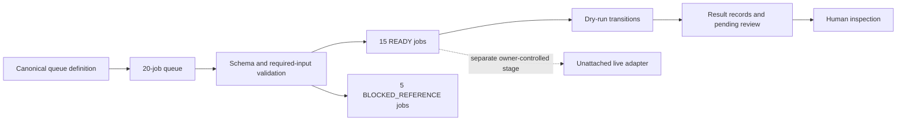

# LTX Content Director Max: architecture

A canonical queue definition generates owner-readable and machine-readable records. Node.js validation checks schema, counts, IDs, required metadata and deterministic output names. The dry-run runner maps READY jobs into transitions and result records. Separate Python helpers support future technical decode, audio assembly and visual-review stages after owner-controlled generation.

- Deterministic identifiers keep a job traceable across preparation, retries and review. They simplify reconciliation but do not establish media quality.
- Controlled variations change bounded creative dimensions while preserving required queue and audio fields. This constrains experimentation and makes a batch easier to compare.
- Keep generation disconnected until review: the live-adapter entrypoint refuses execution. This limits the demo to preparation but prevents a local test from accidentally starting a paid session.

This diagram is a conceptual architecture visual, not a runtime screenshot.

