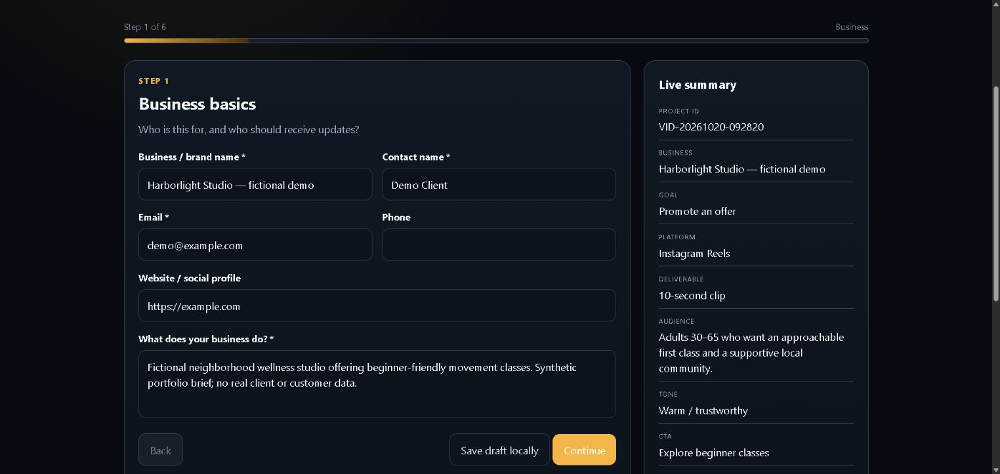
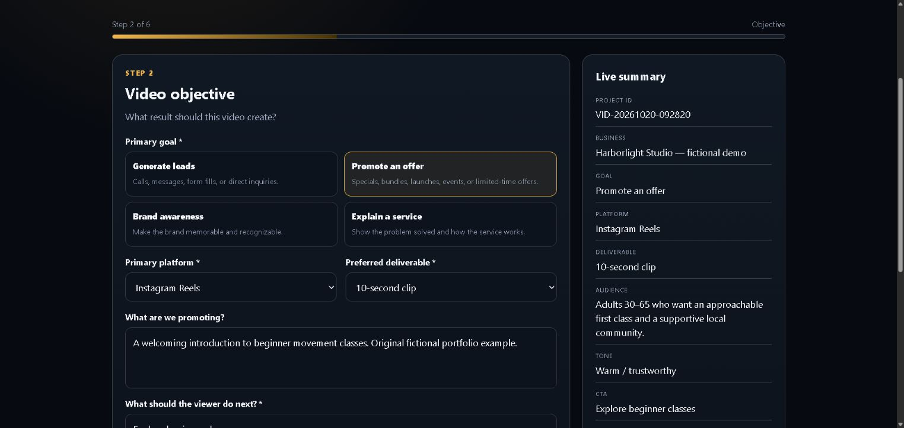
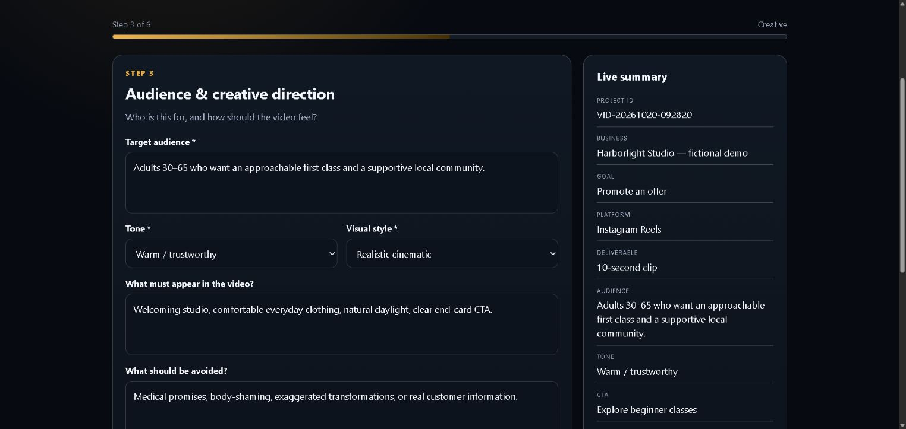
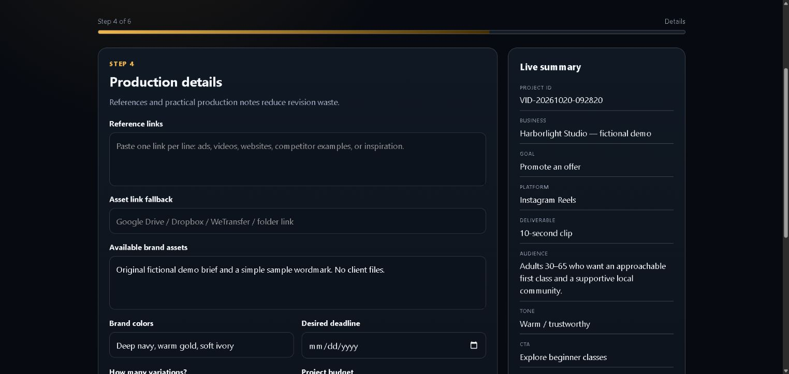
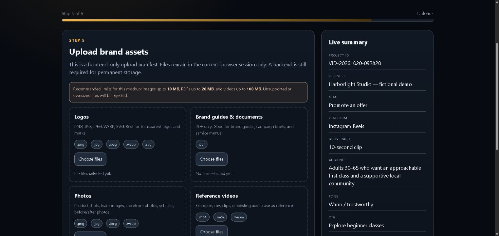
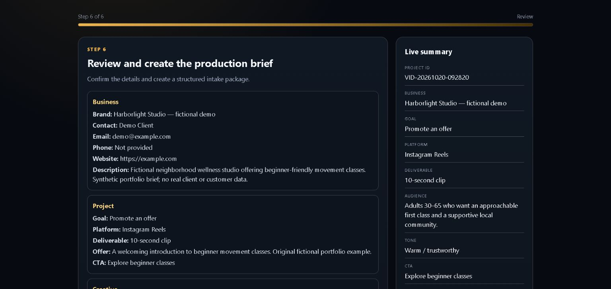
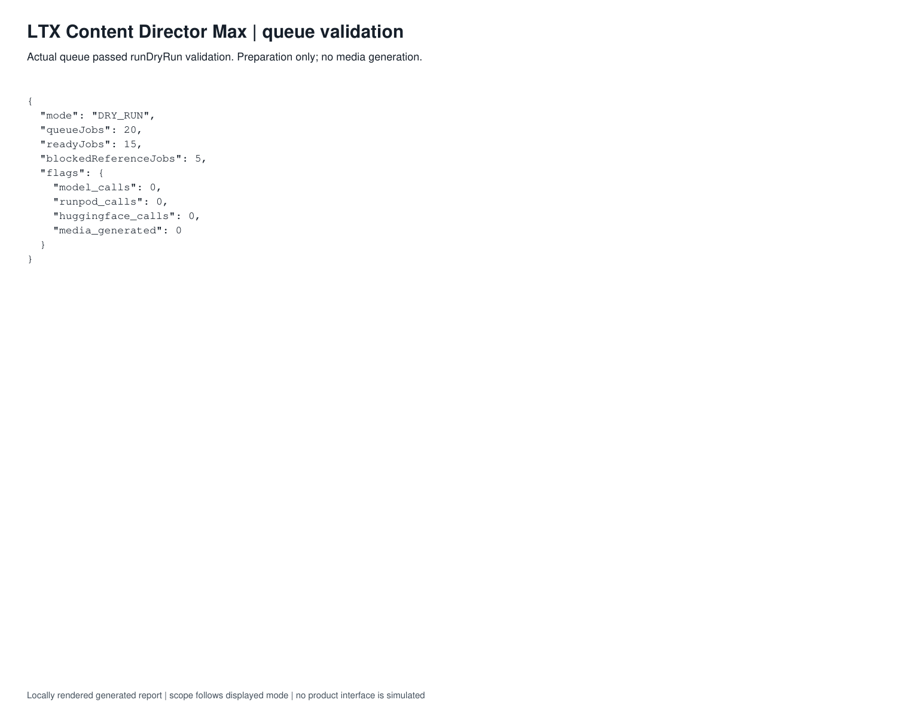
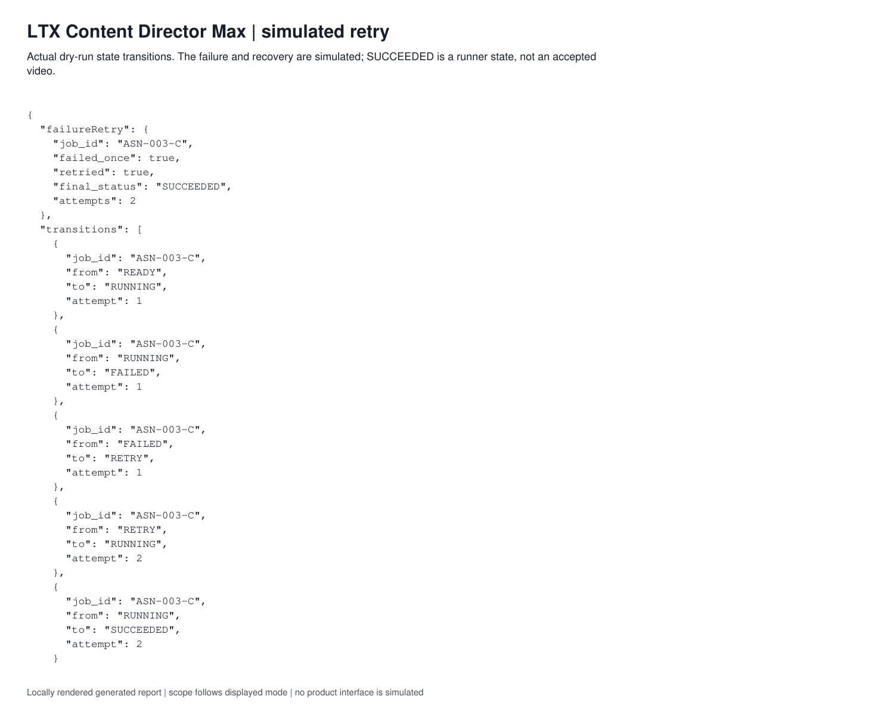
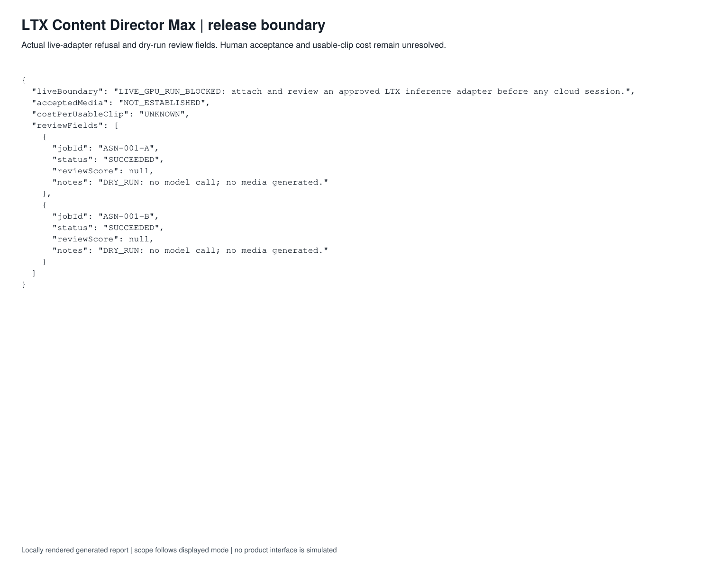

# Demonstrated scope

## Actual interface captures: October 20, 2026

The existing Intake V2 frontend was captured locally on October 20, 2026 with the fictional Harborlight Studio brief and demo@example.com contact. All six steps were visited through the interface. No actual client data or files were used. The upload screen has an empty manifest; file selection, durable storage, exports, generation and runner integration are outside this capture evidence.

[Capture manifest](interface-captures.json)

### Business and contact details

### Video objective and deliverable

### Audience and creative direction

### Production details

### Asset collection interface

### Production brief review

## Earlier component/report evidence

Fresh execution used main commit f75f0209e7f8ec2acefd87bcc174166e46594720. runDryRun validated the queue and processed its 15 ready jobs; the five reference-blocked jobs remained outside the ready set. One failure/retry path was simulated. The adapter refusal was observed. Model, RunPod and Hugging Face calls and generated-media counts were all zero.

Accepted media was not established by this task. Cost per usable clip is UNKNOWN, not zero. No historical clip is included because rights, provenance and acceptance would need separate verification. The live adapter remains unattached; smoke and batch boundaries are not live-production evidence.

## Original report captures

Locally rendered genuine output report; this is not an application UI screenshot. Read its scope and limitations below.

*Locally rendered genuine output report; this is not an application UI screenshot. Read its scope and limitations below.*

*Locally rendered genuine output report; this is not an application UI screenshot. Read its scope and limitations below.*

*Locally rendered genuine output report; this is not an application UI screenshot. Read its scope and limitations below.*

The figures are evidence for the described inputs and version only. No badge, production adoption or business-impact claim is inferred.

## Inspect complete reports

- [Complete ltx overview report](../assets/ltx-overview.pdf) · [JSON](./ltx-overview.json)
- [Complete ltx recovery report](../assets/ltx-recovery.pdf) · [JSON](./ltx-recovery.json)
- [Complete ltx review report](../assets/ltx-review.pdf) · [JSON](./ltx-review.json)
